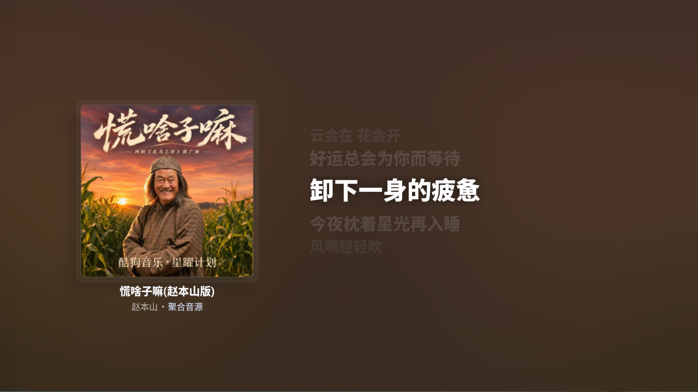
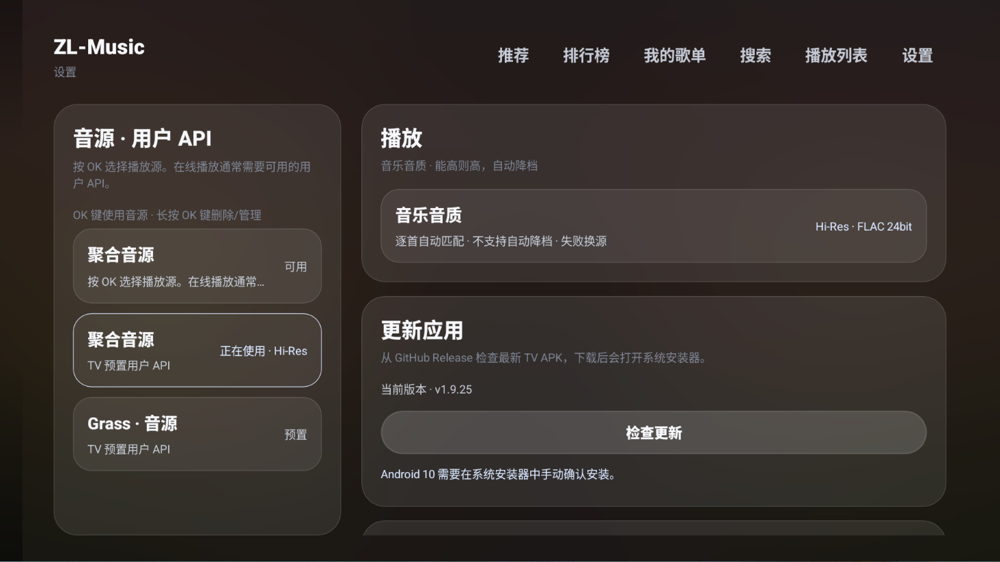
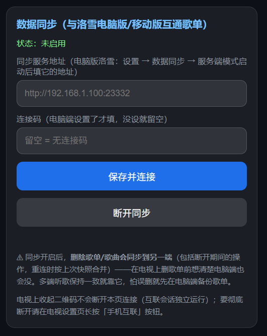

<h1 align="center">ZL-Music TV</h1>

<p align="center"><em>为大屏而生的音乐客厅 · 手机扫码即达的控制台 · 与洛雪生态无缝互通</em></p>

<div align="center">


[](https://github.com/kaosZL/ZL_Musicos/releases)
[](https://github.com/kaosZL/ZL_Musicos/actions)

`arm64-v8a` 大多数电视/盒子 · `universal` 不确定就选它 · `x86_64` 模拟器 · [📋 FAQ](FAQ.md) · [📋 更新日志](https://github.com/kaosZL/ZL_Musicos/releases)

</div>

---

## ✨ 核心亮点

**📱 手机互联控制台** — 电视出码、手机一扫，浏览器即刻变身电视的全功能控制台：音源导入、歌单增删改导出、数据同步配置、实时运行日志，全程无需在电视上输入一个字符。会话全局常驻，关掉二维码也不断连

**🔄 数据同步** — 对接洛雪桌面版 / 移动版同步服务，多端歌单与收藏自动保持一致；首次同步的合并方式在手机页上选择，电视端确认——大屏小屏各司其职

**🎚 四档音质** — 流畅 128K / 高清 320K / 无损 FLAC / Hi-Res 24bit 一键切换；逐首自动匹配可用音质，取链失败同源降档重试、全败才换源，设一次即可永远不用管

**⬆️ 应用内在线更新** — 打开 App 自动检查新版本，国内网络直连镜像下载、一键安装升级，无需侧载

**🎨 沉浸式播放页** — Apple Music TV 版式：背景随专辑主色呼吸浸染、左侧封面右侧歌词、长按歌词进入全屏歌词模式

**🎮 遥控器优先引擎** — 自研空间焦点导航：方向键精准移动、长按呼出上下文菜单、播放页全键位语义化（隐藏态直控切歌 / 呼出态按钮导航），全程不碰鼠标

**🖥 4K 等比适配** — 1080p 观感基准，任意密度 4K 下比例完全一致，只更清晰

**🔍 拼音搜索联想** — 输入 `zjl`、`qt` 直接联想热门歌手和歌曲，全拼匹配自动纠偏

> ⚠️ 本项目仅用于学习、研究与个人设备体验，不内置任何版权音乐资源，不提供付费分发服务；如有权利问题请联系处理或删除相关内容。

---

## 🖼 界面预览

<table>
  <tr>
    <td width="25%" align="center"><sub><b>首页推荐</b></sub><br/></td>
    <td width="25%" align="center"><sub><b>排行榜 · 歌单详情</b></sub><br/></td>
    <td width="25%" align="center"><sub><b>播放页 · 沉浸歌词</b></sub><br/></td>
    <td width="25%" align="center"><sub><b>播放页 · 控制栏</b></sub><br/></td>
  </tr>
  <tr>
    <td width="25%" align="center"><sub><b>播放列表</b></sub><br/></td>
    <td width="25%" align="center"><sub><b>我的歌单</b></sub><br/></td>
    <td width="25%" align="center"><sub><b>设置 · 音质与更新</b></sub><br/></td>
    <td width="25%" align="center"><sub><b>手机互联控制台</b></sub><br/></td>
  </tr>
</table>

> 手机互联页（手机浏览器打开）：音源导入 / 歌单全管理 / 数据同步 / 运行日志——电视上所有需要打字的操作都在这里完成。

---

## 🎮 遥控器操作

| 按键 | 行为 |
| --- | --- |
| 方向键 | 移动焦点 |
| OK / Enter | 打开当前项、播放歌曲或触发按钮 |
| **长按 OK**（音源列表） | 呼出音源操作菜单（删除 / 更新提醒） |
| **长按 OK**（播放列表） | 呼出歌曲菜单：加入我的歌单 / ❤ 收藏 / 从列表删除 |
| **长按 OK**（我的歌单内） | 弹窗确认从歌单删除该歌曲 |
| **长按 OK**（歌单卡片） | 歌单改名（电视屏上键盘；新建/删除在手机页） |
| **长按 OK**（搜索历史标签） | 删除该条搜索历史 |
| OK（播放页·歌词区） | 暂停 / 继续播放（同时呼出控制栏） |
| **长按 OK**（播放页·歌词区） | 进入全屏歌词（OK / Back 退出） |
| Back | 返回上一页（播放页控制栏呼出时先收起控制栏，再按才返回） |
| Play/Pause | 播放页暂停或继续 |
| Previous / Rewind | 播放上一首 |
| Next / Fast Forward | 播放下一首 |
| Menu / 上 / 下（播放页） | 呼出控制栏并聚焦播放键（控制栏常驻，按 Back 收起） |
| 左 / 右（播放页·控制栏未呼出） | 直控上一首 / 下一首 |
| 左 / 右（播放页·控制栏呼出） | 焦点导航：歌词区按时跳焦上一首/下一首按钮，切歌需聚焦按钮后按 OK |

---

## 📋 歌单功能速览

| 场景 | 操作 |
| --- | --- |
| 导入歌单 | 设置 → 手机扫码导入 → 手机页粘贴歌单链接 / 「歌名 - 歌手」清单 / 上传洛雪文件（.json/.lxmc/压缩包） |
| 收藏歌曲 | 播放列表长按 OK → ❤ 我的收藏 |
| 加入歌单 | 播放列表长按 OK 或「全部加入歌单」→ 选目标歌单（按钮带歌曲数，默认加到最前，可切换） |
| 删除歌曲 | 我的歌单 → 打开歌单 → 长按 OK 确认删除 |
| 新建 / 改名 / 删除歌单 | 手机页（扫码进入）：新建歌单、读取后改名（支持中文）/删除；电视长按卡片可屏上改名 |
| 导出备份 | 手机页「读取歌单」→ 导出 → 下载洛雪格式 .json |
| 搜索历史 | 自动记录最近 8 条；长按删单条，一键清空 |

---

<details>
<summary><b>🌟 全部特性（点击展开）</b></summary>

**播放体验**
- 播放页 Apple Music TV 风格沉浸式布局：左侧封面、右侧歌词与封面垂直对齐、底部进度条、右下角圆形控制；控制栏呼出后常驻，按返回键收起。
- 专辑主色动态背景：原生层从封面提取主色（HSV 分桶取主调并压暗），背景随切歌平滑浸染；顶/底压暗为 512 级平滑渐变，无色带无方块。
- 全屏歌词：播放页歌词区长按 OK 进入大字歌词模式，OK / Back 退出。
- 播放键状态锁存：取新歌链接的 1-2 秒间隙，播放键不再闪「已暂停」。
- 播放保活：播放中持有屏幕常亮，系统屏保不会打断音乐（华为智慧屏等实测）。
- 切后台自动暂停：TV 端切到后台自动暂停，切回不自动恢复。

**手机互联控制台**
- 扫码即达：电视出二维码，手机浏览器打开全功能控制台；会话全局常驻——收起二维码、退出设置页都不断连，长按确认才真正关闭。
- 音源导入：粘贴脚本链接或 JS 内容一键导入；支持删除、切换已装音源。
- 歌单全管理：新建 / 中文改名 / 删除 / 导出洛雪格式 .json 备份，全部在手机页完成。
- 数据同步：配置洛雪桌面版/移动版同步服务地址与连接码，多端歌单收藏自动一致；覆盖类操作二次确认，同步生命周期实时写入运行日志。
- 运行日志：3 秒轮询实时日志、可暂停、一键复制，排查音源问题不用连 adb。

**音质与音源**
- 四档音质（128K / 320K / FLAC / Hi-Res 24bit）：逐首自动匹配，歌曲或音源不支持自动降档；取链失败先同源降档重试、全败才换源。
- 完整音源管理：所有音源（用户导入 / 预置 / 内置）均可删除；删除正在使用的音源自动回退聚合音源，当前歌曲播完为止。
- 音源名洛雪惯例缩写（KW / KG / TX / WY / MG），全 App 统一。

**系统与工程**
- 应用内在线更新：启动自动检查新版本（每日一次、静默失败不打扰），发现新版弹窗引导；检查与下载全链路国内镜像可达，一键安装。
- 自研遥控焦点引擎：空间方向打分 + 同排优先 + 显式导航链 + 按键合并排队，长按判定 550ms 兜底（兼容无 OK 连发固件）；34 项单元测试护航。
- 弹窗体系：统一毛玻璃卡片、左右切按钮、默认聚焦主操作、返回键关闭。
- 4K 等比适配：1080p 观感基准，任意密度下比例恒定；拼音搜索联想（204 位歌手 + 221 首歌曲词典）；搜索/排行榜 KW/KG/TX/WY/MG 子源筛选；APK 混淆精简至约 55MB。

**歌单与列表**
- 歌单导入：网易云/QQ/酷狗/酷我/咪咕歌单链接、「歌名 - 歌手」清单（逐首匹配、未匹配点名告知）、洛雪文件（.json/.lxmc/压缩包）；中文全程无损。
- 「我的歌单」卡片带歌曲数与首图封面；播放列表长按加入歌单（选择器带数量、已存在如实提示）；「全部加入歌单」一键导入；❤ 收藏与自建歌单同权。
- 在线歌单/排行榜分页加载（滚到底拉取全量、失败可重试）；搜索历史最近 8 条持久化。

</details>

## 🛠 构建与开发

📖 **完整开发文档：[docs/DEVELOPMENT.md](docs/DEVELOPMENT.md)**——按键链路、自研焦点引擎、音源/音质、更新分发、发版流程、历史坑与修改守则，参与开发前必读。

<details>
<summary><b>点击展开</b></summary>

**环境要求**：Node.js 20+ / npm 8.5+ / JDK 17 / Android SDK / Gradle / Android TV、盒子或模拟器

**本地构建**：

```bash
npm install
npm run tv:assemble
```

构建产物位于（五种架构，文件名带 `-lulu` 本地包标记，与官方发布包区分）：

```text
android/app/build/outputs/apk/release/zl-music-<版本>-lulu-arm64-v8a.apk
android/app/build/outputs/apk/release/zl-music-<版本>-lulu-armeabi-v7a.apk
android/app/build/outputs/apk/release/zl-music-<版本>-lulu-x86_64.apk
android/app/build/outputs/apk/release/zl-music-<版本>-lulu-x86.apk
android/app/build/outputs/apk/release/zl-music-<版本>-lulu-universal.apk
```

应用包名：`cn.toside.music.mobile`

**代码检查**：

```bash
npm run tv:lint
```

**ADB 模拟遥控器**：

```bash
npm run tv:remote -- up
npm run tv:remote -- right right ok
npm run tv:remote -- back
adb shell input keyevent 82   # 模拟 Menu 键
adb connect 127.0.0.1:62001
adb -s 127.0.0.1:62001 install -r android/app/build/outputs/apk/release/zl-music-<版本>-lulu-x86_64.apk
```

**CI 云构建**：每次 push 到 master / dev 自动构建 release APK（R8 混淆 + debug 签名，可直接安装），[Actions](https://github.com/kaosZL/ZL_Musicos/actions) 页面最新成功构建底部 Artifacts 下载。

**目录结构**：

```text
src/
  components/TV/      TV 端基础组件（焦点、卡片、按钮、面板、TVDialog 统一弹窗）
  screens/TV/         TV 首页、排行榜、搜索、设置（扫码导入+音源管理）、播放页、队列页
  config/hotArtists.ts  热门歌手拼音词典（搜索联想）
  config/hotSongs.ts    热门歌曲拼音词典（搜索联想）
  theme/tv.ts         TV 设计 token + 全分辨率等比缩放
android/
  app/src/main/java/.../utils/LanImportServer.java   局域网扫码导入服务（NanoHTTPD）
  app/src/main/assets/lan_input.html                 手机端导入页
  app/src/main/assets/script/                        预置音源脚本
.github/workflows/build-apk.yml    CI 云构建（push 自动出 APK）
docs/screenshots/     README 使用的 TV 截图
```

</details>

## 📦 适配设备

- 全部分辨率等比适配，已在 75 寸 4K Android TV（FF 75S595C Ultra，3840x2160 / 4GB+64GB）实测。
- `arm64-v8a`：大多数 64 位 Android TV / 盒子；`universal`：不确定设备架构时使用；`x86_64`：模拟器。

## 🙌 致谢

- [lx-music-mobile](https://github.com/lyswhut/lx-music-mobile)：原始移动端项目。
- Apple Music TV / tvOS：TV 端布局、比例和沉浸式播放页的视觉参考。
- Codex：本仓库 TV 端开发、调试、打包、截图巡检和 README 整理的主要协作者。

沿用原项目协议，详见 [LICENSE](LICENSE)。

## ⭐ Star History

<picture>
  <source media="(prefers-color-scheme: dark)" srcset="https://api.star-history.com/svg?repos=kaosZL/ZL_Musicos&type=Date&theme=dark" />
  <source media="(prefers-color-scheme: light)" srcset="https://api.star-history.com/svg?repos=kaosZL/ZL_Musicos&type=Date" />
  
</picture>


