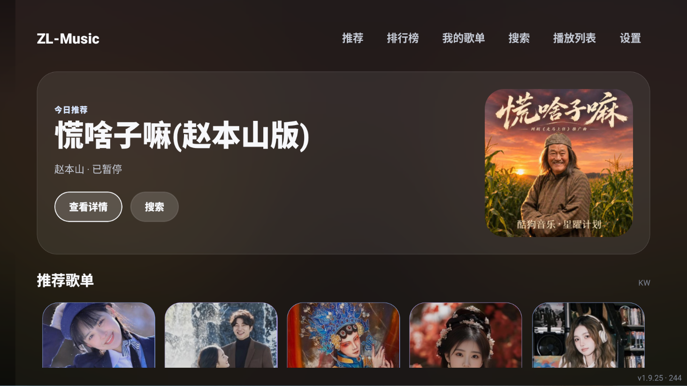
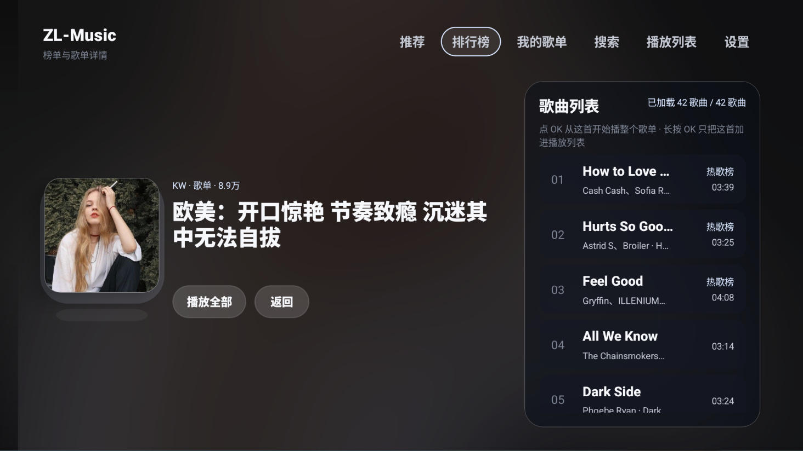
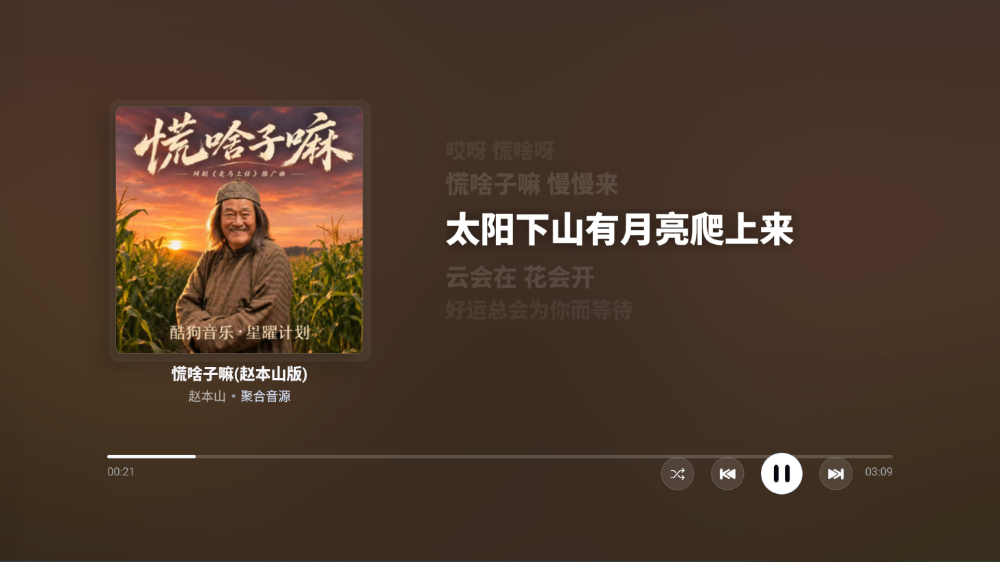
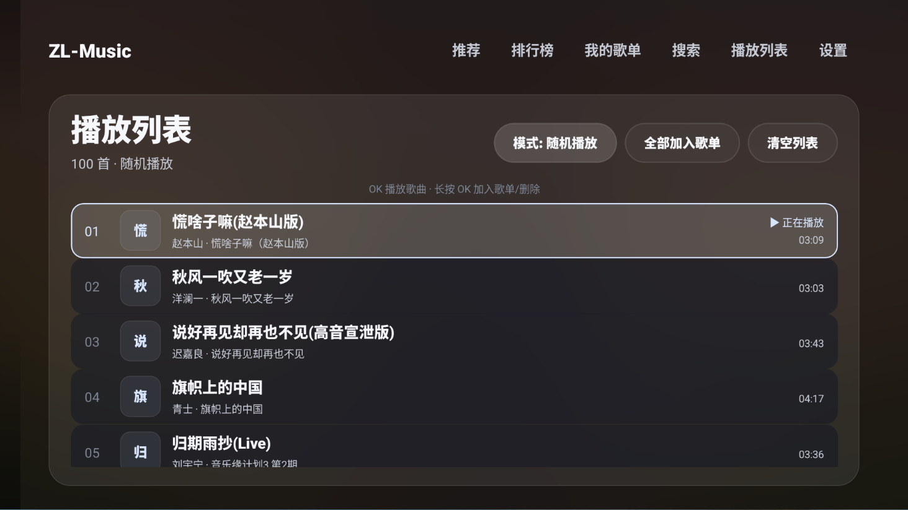
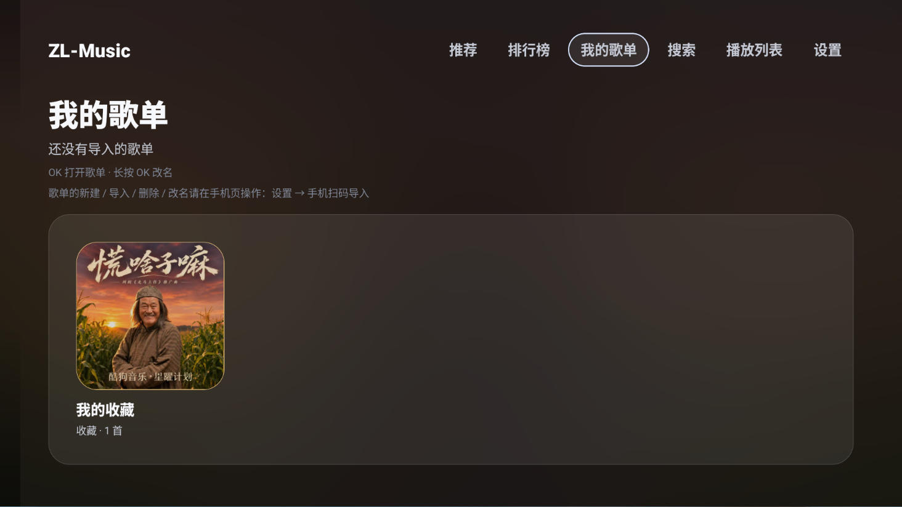
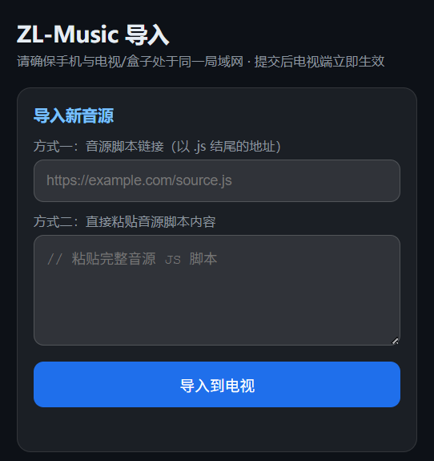
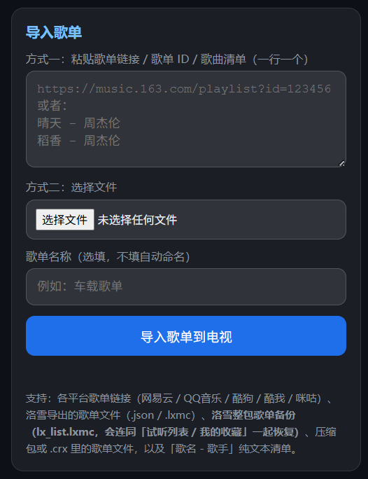
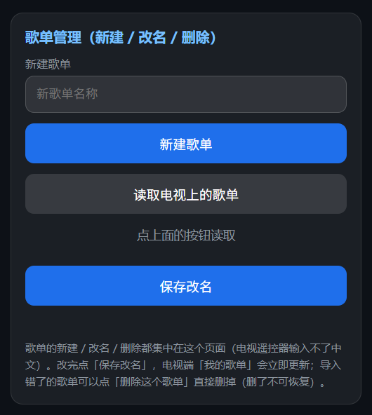
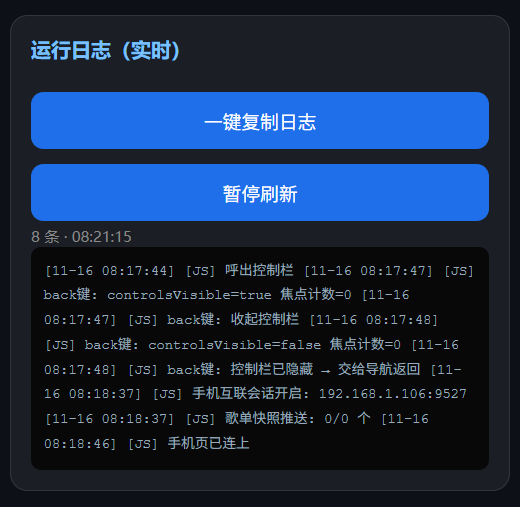

<h1 align="center">ZL-Music TV</h1>

<p align="center"><em>把客厅变成音乐厅 —— 大屏沉浸播放 · 手机扫码掌控 · 洛雪生态互通</em></p>

<div align="center">


[](https://github.com/kaosZL/ZL_Musicos/releases)
[](docs/DEVELOPMENT.md)

</div>


---

## 这是什么

一台电视、一个遥控器、一部手机——**电视负责好看好听，手机负责一切输入**。

ZL-Music TV 是面向 Android TV / 盒子的洛雪生态音乐播放器：播放页随专辑主色呼吸浸染，
歌单与收藏通过洛雪同步服务在所有设备间流转，音源脚本、歌单导入、数据同步、故障排查
全部在手机浏览器上一扫即达。装好之后，你几乎不需要再碰电视上的输入框。

> ⚠️ 本项目仅用于学习、研究与个人设备体验，不内置任何版权音乐资源，不提供付费分发服务；如有权利问题请联系处理或删除相关内容。

---

## ✨ 功能全景

| | |
| --- | --- |
| 🎨 **沉浸播放** | Apple Music TV 版式，背景随专辑主色浸染流转；长按歌词进入全屏歌词 |
| 🔄 **数据同步** | 对接洛雪桌面版/移动版同步服务，或自部署 [lx-music-sync-server](https://github.com/lyswhut/lx-music-sync-server) 作私人多端同步；首次合并手机选方式、电视做确认 |
| 📱 **互联控制台** | 手机扫码即达的网页控制台：音源、歌单、同步、日志——会话常驻，关码不断连 |
| 🎚 **四档音质** | 128K / 320K / FLAC / Hi-Res 24bit；逐首自动匹配，取链失败自动降档，设一次不用管 |
| ⬆️ **在线更新** | 启动自动检查新版本，国内镜像直连下载、一键安装，告别侧载 |
| 🎮 **遥控引擎** | 自研空间焦点导航：方向精准移动、长按呼出菜单、播放页全键位语义化 |
| 🖥 **4K 恒定版式** | 1080p 观感基准，任意密度 4K 比例完全一致，只更清晰 |
| 🔍 **拼音联想** | `zjl`、`qt` 即出「猜你想搜」，204 位歌手 + 221 首歌曲内置词典 |

---

## 🖥 大屏界面

<table>
  <tr>
    <td width="33%" align="center"><sub><b>首页 · 今日推荐</b></sub><br/></td>
    <td width="33%" align="center"><sub><b>排行榜 · 歌单详情</b></sub><br/></td>
    <td width="33%" align="center"><sub><b>播放页 · 控制栏</b></sub><br/></td>
  </tr>
  <tr>
    <td width="33%" align="center"><sub><b>播放列表 · 长按管理</b></sub><br/></td>
    <td width="33%" align="center"><sub><b>我的歌单</b></sub><br/></td>
    <td width="33%" align="center"><sub><b>设置 · 音质与更新</b></sub><br/></td>
  </tr>
</table>

---

## 📱 手机互联控制台

电视上所有需要打字的操作，都在手机浏览器完成。设置页按 OK 出示二维码，手机一扫即达——
会话全局常驻：收起二维码、退出设置页都不断连，**长按确认才真正关闭**。

<table>
  <tr>
    <td width="33%" align="center"><sub><b>音源导入</b></sub><br/></td>
    <td width="33%" align="center"><sub><b>歌单导入</b></sub><br/></td>
    <td width="33%" align="center"><sub><b>歌单管理</b></sub><br/></td>
  </tr>
  <tr>
    <td width="33%" align="center"><sub><b>数据同步</b></sub><br/></td>
    <td width="33%" align="center"><sub><b>运行日志</b></sub><br/></td>
    <td width="33%"></td>
  </tr>
</table>

- **音源导入**：粘贴脚本链接或 JS 内容一键导入，已装音源可切换、可删除
- **歌单导入**：网易云 / QQ / 酷狗 / 酷我 / 咪咕歌单链接、「歌名 - 歌手」清单、洛雪文件（.json / .lxmc / 压缩包）
- **歌单管理**：新建、中文改名、删除、导出洛雪格式备份
- **数据同步**：填入洛雪同步服务地址与连接码即连，覆盖类操作二次确认
- **运行日志**：3 秒实时滚动、可暂停、一键复制——排障不用连电脑

> 💡 **私人多端同步**：洛雪官方提供独立的数据同步服务 [lx-music-sync-server](https://github.com/lyswhut/lx-music-sync-server)——有自己的服务器即可部署为私人同步服务，电视端在手机互联页填入其地址接入，多台设备（含洛雪桌面版/移动版）共享同一歌单与收藏。

---

## 🚀 快速上手

1. **安装**：[Releases](https://github.com/kaosZL/ZL_Musicos/releases) 下载 APK（`arm64-v8a` 大多数电视；拿不准选 `universal`），U 盘或局域网传输安装
2. **导音源**：设置 → 手机扫码导入 → 手机页粘贴洛雪音源脚本链接 → 导入
3. **开始听**：首页听推荐、排行榜挑歌单、搜索栏输 `zjl` 试试——之后 App 会自动提醒新版本，直接在线升级

---

## 🎮 遥控器语义

| 按键 | 行为 |
| --- | --- |
| 方向键 | 移动焦点（空间导航引擎） |
| OK | 打开 / 播放 / 触发；播放页歌词区 = 暂停·继续 |
| **长按 OK** | 上下文菜单：列表项加歌单/收藏/删除、歌单卡片改名、搜索历史删单条、歌词区进全屏歌词 |
| Menu / 上 / 下（播放页） | 呼出控制栏并聚焦播放键（常驻，Back 收起） |
| 左 / 右（播放页·栏隐藏） | 直控上一首 / 下一首 |
| 左 / 右（播放页·栏呼出） | 焦点导航，切歌聚焦按钮后按 OK |
| Back | 关弹窗 / 收控制栏 / 返回上页 |
| 媒体键 | 播放暂停 / 上下曲，全局响应 |

---

## 📋 歌单能力速览

| 场景 | 操作 |
| --- | --- |
| 导入歌单 | 手机页：链接 / 清单 / 洛雪文件，中文全程无损 |
| 收藏与加歌 | 播放列表长按 OK → ❤ 收藏 / 选歌单（带数量、防重复提示） |
| 新建 / 改名 / 删除 | 手机页集中管理；电视长按卡片可屏上改名 |
| 导出备份 | 手机页一键导出洛雪格式 .json |
| 数据同步 | 手机页配置同步服务 → 多端自动一致 |

---

<details>
<summary><b>🌟 全部特性（点击展开）</b></summary>

**播放体验**
- 播放页 Apple Music TV 风格沉浸式布局：左侧封面、右侧歌词与封面垂直对齐、底部进度条、右下角圆形控制；控制栏呼出后常驻，按返回键收起。
- 专辑主色动态背景：原生层从封面提取主色（HSV 分桶取主调并压暗），背景随切歌平滑浸染；顶/底压暗为 512 级平滑渐变，无色带无方块。
- 全屏歌词：播放页歌词区长按 OK 进入大字歌词模式，OK / Back 退出。
- 播放键状态锁存：取新歌链接的 1-2 秒间隙，播放键不再闪「已暂停」。
- 播放保活：播放中持有屏幕常亮，系统屏保不会打断音乐（华为智慧屏等实测）。
- 切后台自动暂停：TV 端切到后台自动暂停，切回不自动恢复。

**手机互联控制台**
- 扫码即达：电视出二维码，手机浏览器打开全功能控制台；会话全局常驻——收起二维码、退出设置页都不断连，长按确认才真正关闭。
- 音源导入：粘贴脚本链接或 JS 内容一键导入；支持删除、切换已装音源。
- 歌单全管理：新建 / 中文改名 / 删除 / 导出洛雪格式 .json 备份，全部在手机页完成。
- 数据同步：配置洛雪桌面版/移动版同步服务地址与连接码，多端歌单收藏自动一致；覆盖类操作二次确认，同步生命周期实时写入运行日志。
- 运行日志：3 秒轮询实时日志、可暂停、一键复制，排查音源问题不用连 adb。

**音质与音源**
- 四档音质（128K / 320K / FLAC / Hi-Res 24bit）：逐首自动匹配，歌曲或音源不支持自动降档；取链失败先同源降档重试、全败才换源。
- 完整音源管理：所有音源（用户导入 / 预置 / 内置）均可删除；删除正在使用的音源自动回退聚合音源，当前歌曲播完为止。
- 音源名洛雪惯例缩写（KW / KG / TX / WY / MG），全 App 统一。

**系统与工程**
- 应用内在线更新：启动自动检查新版本（每日一次、静默失败不打扰），发现新版弹窗引导；检查与下载全链路国内镜像可达，一键安装。
- 自研遥控焦点引擎：空间方向打分 + 同排优先 + 显式导航链 + 按键合并排队，长按判定 550ms 兜底（兼容无 OK 连发固件）；34 项单元测试护航。
- 弹窗体系：统一毛玻璃卡片、左右切按钮、默认聚焦主操作、返回键关闭。
- 4K 等比适配：1080p 观感基准，任意密度下比例恒定；拼音搜索联想；搜索/排行榜 KW/KG/TX/WY/MG 子源筛选；APK 混淆精简至约 55MB。

**歌单与列表**
- 歌单导入：网易云/QQ/酷狗/酷我/咪咕歌单链接、「歌名 - 歌手」清单（逐首匹配、未匹配点名告知）、洛雪文件（.json/.lxmc/压缩包）；中文全程无损。
- 「我的歌单」卡片带歌曲数与首图封面；播放列表长按加入歌单（选择器带数量、已存在如实提示）；「全部加入歌单」一键导入；❤ 收藏与自建歌单同权。
- 在线歌单/排行榜分页加载（滚到底拉取全量、失败可重试）；搜索历史最近 8 条持久化。

</details>

## 🛠 构建与开发

📖 **完整开发文档：[docs/DEVELOPMENT.md](docs/DEVELOPMENT.md)**——按键链路、自研焦点引擎、音源/音质、更新分发、发版流程、历史坑与修改守则，参与开发前必读。

<details>
<summary><b>点击展开</b></summary>

**环境要求**：Node.js 20+ / npm 8.5+ / JDK 17 / Android SDK / Gradle / Android TV、盒子或模拟器

**本地构建**：

```bash
npm install
npm run tv:assemble
```

构建产物位于（五种架构，文件名带 `-lulu` 本地包标记，与官方发布包区分）：

```text
android/app/build/outputs/apk/release/zl-music-<版本>-lulu-arm64-v8a.apk
android/app/build/outputs/apk/release/zl-music-<版本>-lulu-armeabi-v7a.apk
android/app/build/outputs/apk/release/zl-music-<版本>-lulu-x86_64.apk
android/app/build/outputs/apk/release/zl-music-<版本>-lulu-x86.apk
android/app/build/outputs/apk/release/zl-music-<版本>-lulu-universal.apk
```

应用包名：`cn.toside.music.mobile`

**代码检查与单测**：

```bash
npm run tv:lint
npm test          # 34 项单元测试（焦点引擎/歌词过滤/镜像链/直控门控）
```

**ADB 模拟遥控器**：

```bash
npm run tv:remote -- up
npm run tv:remote -- right right ok
adb shell input keyevent 82   # 模拟 Menu 键
```

**CI 云构建**：push 到 master / dev 自动构建 release APK（R8 混淆），[Actions](https://github.com/kaosZL/ZL_Musicos/actions) 页 Artifacts 下载；master 发版自动上传 Release 并维护应用内更新清单。

</details>

## 📦 适配设备

- 全分辨率等比适配，已在 75 寸 4K Android TV（FF 75S595C Ultra）与多品牌电视/盒子实测。
- `arm64-v8a`：大多数 64 位电视/盒子 · `universal`：不确定就选它 · `x86_64`：模拟器 · 常见问题见 [FAQ](FAQ.md)

## 🙌 致谢

- [lx-music-mobile](https://github.com/lyswhut/lx-music-mobile)：原始移动端项目
- Apple Music TV / tvOS：大屏版式与沉浸式播放页的视觉参考
- 所有提出 issue 与实测反馈的用户

沿用原项目协议，详见 [LICENSE](LICENSE)。

## ⭐ Star History

<picture>
  <source media="(prefers-color-scheme: dark)" srcset="https://api.star-history.com/svg?repos=kaosZL/ZL_Musicos&type=Date&theme=dark" />
  <source media="(prefers-color-scheme: light)" srcset="https://api.star-history.com/svg?repos=kaosZL/ZL_Musicos&type=Date" />
  
</picture>


